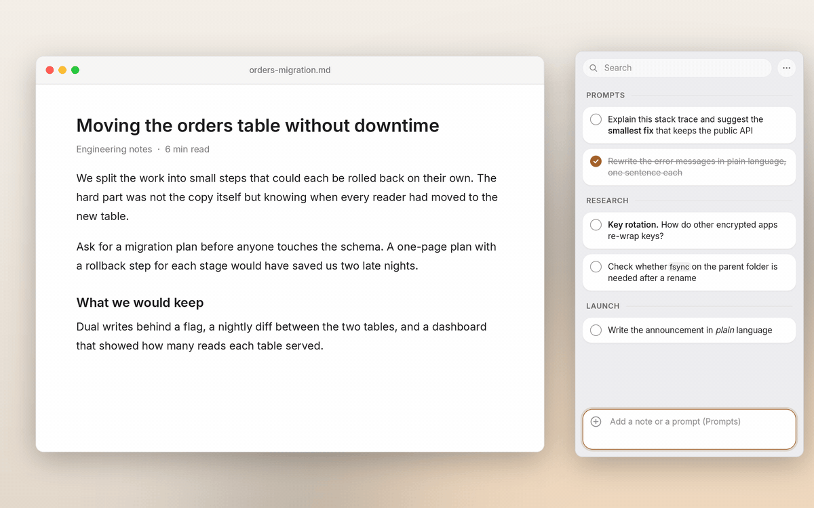
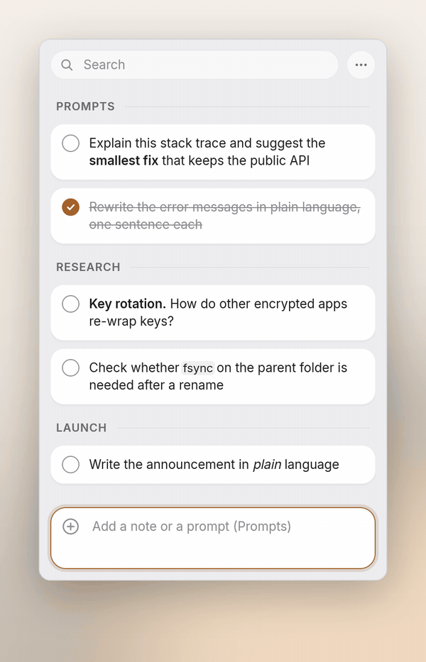
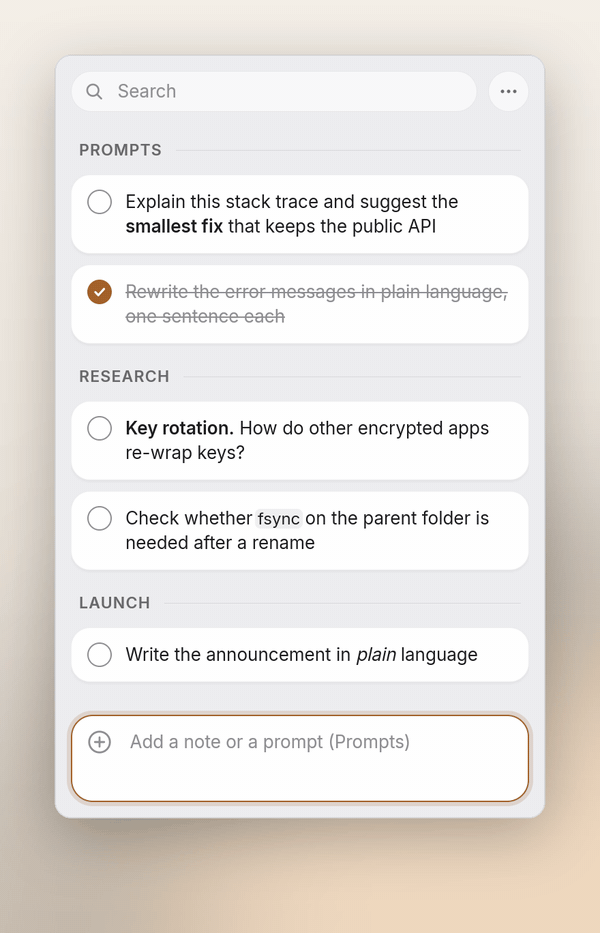
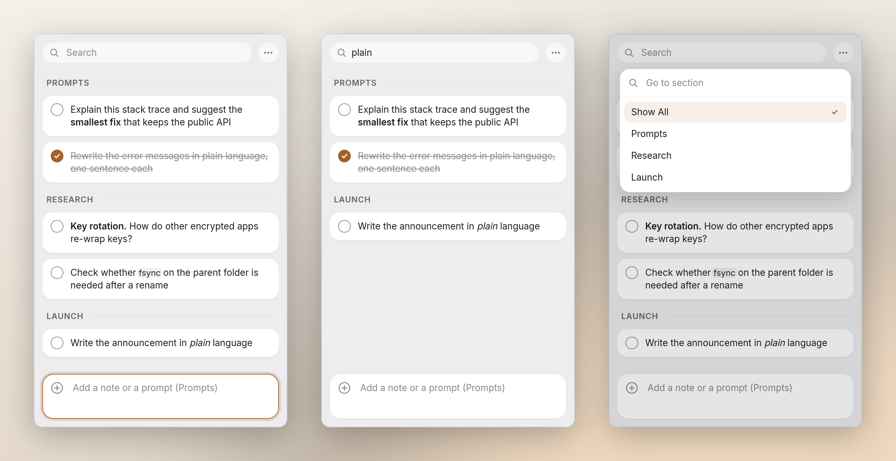

  <picture>
    <source media="(prefers-color-scheme: dark)" srcset="assets/brand/logo-dark.svg">
    
  </picture>

<h3 align="center">Select anything. Press a key. It lands in Bronze.</h3>

  A capture panel for notes and prompts on Mac and Windows, with end-to-end encrypted sync you host yourself.

  
  
  
  

  <picture>
    <source media="(prefers-color-scheme: dark)" srcset="docs/media/hero-dark.png">
    
  </picture>

Bronze is part to-do list, part clipboard, part scratchpad.
Select text in any app, press the capture shortcut, and it lands in Bronze.
Queue the prompts you want to try next, copy them back out, and check them off.
Notes live in one local file, and sync to your own `bronze-sync` server is end-to-end encrypted, so the server only ever stores ciphertext.

## Capture from anywhere

Double-tap Left Shift on the Mac and Windows, or press `Ctrl+Alt+C`, and the selected text becomes a note.

<picture>
  <source media="(prefers-color-scheme: dark)" srcset="docs/media/capture-dark.gif">
  
</picture>

## Queue, check off, find

<table>
  <tr>
    <td width="50%" align="center">
      <picture>
        <source media="(prefers-color-scheme: dark)" srcset="docs/media/queue-dark.gif">
        
      </picture>
       Type a note in Markdown, check it off, jump to a section with <code>⌘K</code>.
    </td>
    <td width="50%" align="center">
      <picture>
        <source media="(prefers-color-scheme: dark)" srcset="docs/media/search-dark.gif">
        
      </picture>
       Search every section as you type.
    </td>
  </tr>
</table>

<picture>
  <source media="(prefers-color-scheme: dark)" srcset="docs/media/tour-dark.png">
  
</picture>

---

> **Preview notes, not part of the README.**
> Everything above this line is the proposed top of `README.md`; the existing Run, Mac, Windows, Shortcuts and Check sections would follow unchanged.
> A sync section with a GIF of two machines syncing waits for the sync work to merge; see `docs/media/README.md`.
> The license badge links to `LICENSE`, which lands with the open-source PR.
