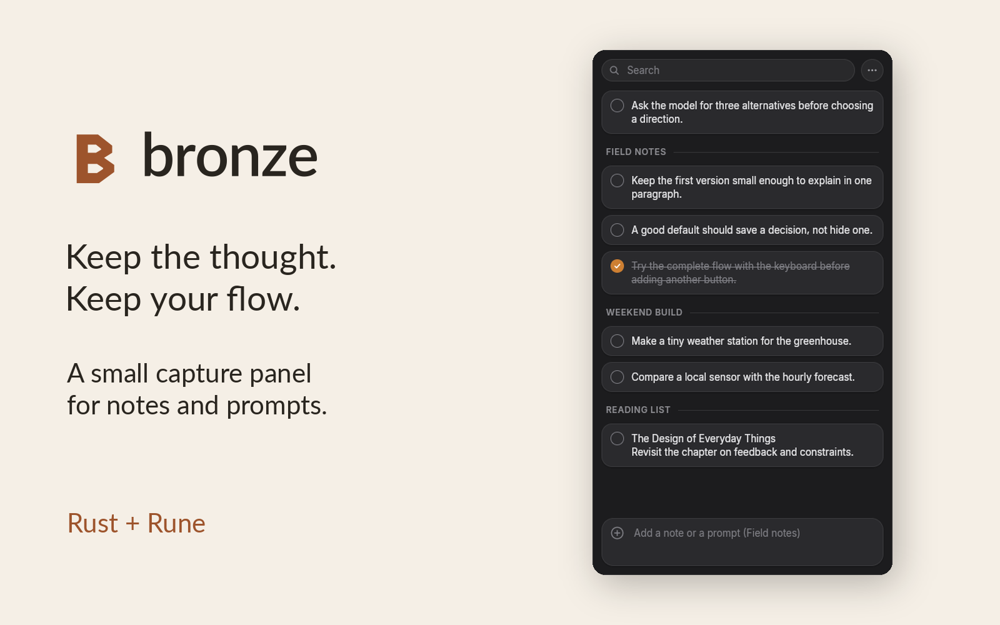
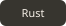
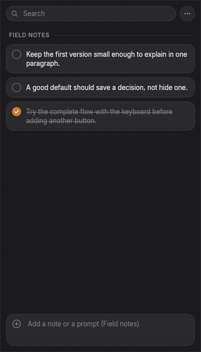
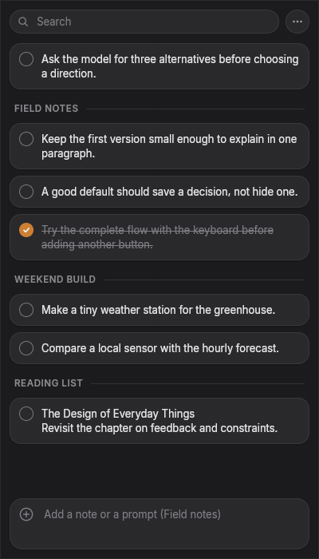
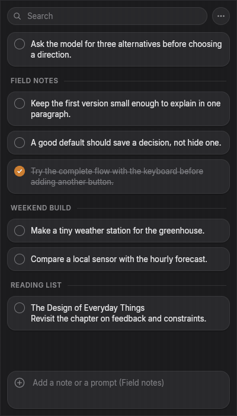

<p align="center">
  <picture>
    <source media="(prefers-color-scheme: dark)" srcset="docs/media/hero-dark.png">
    
  </picture>
</p>

<h1 align="center">Bronze</h1>
<p align="center">Capture a thought, queue a prompt, and get back to your work.</p>

<p align="center">
  
  
  
  
</p>

Select text in any app and press a shortcut to save it in Bronze.
Find it with search, group it into a section, copy it back out, or check it off.
Your notes stay in a local file.

## A few seconds of Bronze

<table>
  <tr>
    <th>Capture selected text</th>
    <th>Find a note</th>
    <th>Jump to a section</th>
  </tr>
  <tr>
    <td></td>
    <td></td>
    <td></td>
  </tr>
</table>

These recordings show the running native app on a Linux development host, using invented notes.
[View the full screenshots and capture details](docs/media/README.md).

## Run locally

```sh
cargo run -- --data ./bronze-demo
```

[Read the setup and keyboard shortcuts](README.md).

This is a proposed README opening for asset set B, made by GPT-6.1 Sol on high.
It does not replace the current README.
The encrypted sync demo will be recorded after N-226 lands and two fixture clients can exchange a note through bronze-sync.
The MIT badge is deferred until the license file lands.
