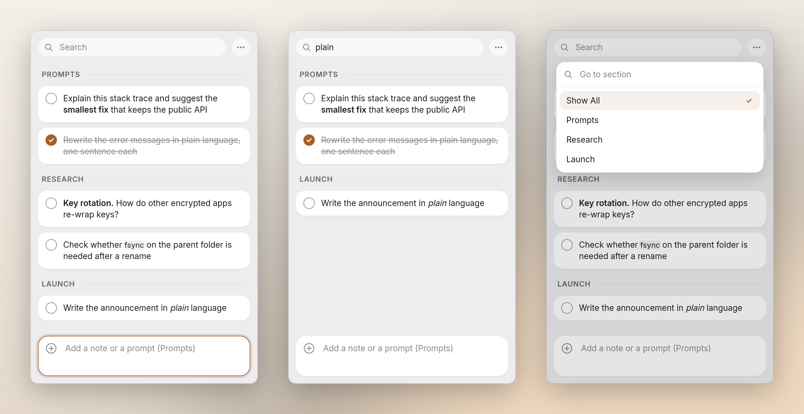

<p align="center">
  <picture>
    <source media="(prefers-color-scheme: dark)" srcset="assets/brand/logo-dark.svg">
    
  </picture>
</p>

<h3 align="center">Select anything. Press a key. It lands in Bronze.</h3>

<p align="center">
  A capture panel for notes and prompts on macOS, Windows and Linux, with end-to-end encrypted sync you host yourself.
</p>

<p align="center">
  <a href="https://github.com/bryceeppler/bronze/releases/latest"></a>
  
  
  
  <a href="LICENSE"></a>
</p>

<p align="center">
  <picture>
    <source media="(prefers-color-scheme: dark)" srcset="docs/media/hero-dark.png">
    
  </picture>
</p>

Bronze is part to-do list, part clipboard, part scratchpad.
Select text in any app, press the capture shortcut, and it lands in Bronze.
Queue the prompts you want to try next, copy them back out, and check them off.

Notes live in one local file on your machine, with no account and no telemetry.
Sync to your own `bronze-sync` server is optional and end-to-end encrypted, so the server only ever stores ciphertext.

Bronze is written in Rust on [Rune](https://github.com/anomalyco/rune) and is inspired by shadcn's Copper, which is Mac only.
It is an independent project and is not affiliated with shadcn.

## Capture from anywhere

Press `Ctrl+Alt+C`, or double-tap Left Shift, and the selected text becomes a note.

<picture>
  <source media="(prefers-color-scheme: dark)" srcset="docs/media/capture-dark.gif">
  
</picture>

## Queue, check off, find

<table>
  <tr>
    <td width="50%" align="center">
      <picture>
        <source media="(prefers-color-scheme: dark)" srcset="docs/media/queue-dark.gif">
        
      </picture>
      <br><sub>Type a note in Markdown, check it off, jump to a section with <code>Ctrl/Cmd+K</code>.</sub>
    </td>
    <td width="50%" align="center">
      <picture>
        <source media="(prefers-color-scheme: dark)" srcset="docs/media/search-dark.gif">
        
      </picture>
      <br><sub>Search every section as you type.</sub>
    </td>
  </tr>
</table>

<picture>
  <source media="(prefers-color-scheme: dark)" srcset="docs/media/tour-dark.png">
  
</picture>

## Install

Download Bronze for your system from the [latest release](https://github.com/bryceeppler/bronze/releases/latest).
The release lists a SHA-256 checksum for each download, also attached as `SHA256SUMS.txt`.

| System | Download |
| --- | --- |
| macOS 14 or later, Apple silicon | `Bronze-<version>-macos-arm64.zip` |
| Windows 10 or 11, 64-bit | `bronze-<version>-windows-x86_64.zip` |
| Linux, x86-64, glibc 2.35 or later, such as Ubuntu 22.04 or Debian 12 and newer | `bronze-<version>-linux-x86_64.tar.gz` |

The downloads are not notarized by Apple or signed for Windows yet, so each system warns you the first time.
If you would rather not run a prebuilt binary, [build Bronze from source](#build-from-source).

### macOS

1. Unzip the download and move `Bronze.app` to your Applications folder.
2. Open Bronze. macOS says Apple could not verify that Bronze is free of malware; choose **Done**.
3. Open **System Settings**, then **Privacy & Security**, scroll down to the message about Bronze, and choose **Open Anyway**.
   Confirm with your password, then choose **Open Anyway** once more.
4. Bronze asks for Accessibility access: choose **Open Settings** in the notice and turn Bronze on under **Accessibility**.
   You grant this once; the notice goes away by itself.

Then double-tap Left Shift to capture the selected text, and press Right Shift with Left Shift to show or hide Bronze.

### Windows

1. Unzip the download and put `bronze.exe` wherever you keep apps, such as a `Bronze` folder in your user folder.
2. Open `bronze.exe`. SmartScreen says Windows protected your PC; choose **More info**, then **Run anyway**.
   Windows asks only the first time.

Bronze needs no permission on Windows.
Double-tap Left Shift to capture the selected text, and press Right Shift with Left Shift to show or hide Bronze.
Both Shift gestures are ignored while a full-screen app such as a game is in front, and `Ctrl+Alt+C` and `Ctrl+Alt+Space` still work there.
While an app running as administrator has focus, Windows keeps its keys and its text from Bronze, so the gestures do nothing there and capture finds nothing.
To start Bronze when you sign in, put a shortcut to `bronze.exe` in the folder that `Win+R`, `shell:startup` opens.
Bronze has no console window; to keep its log, open PowerShell in its folder and run `Start-Process .\bronze.exe -RedirectStandardError bronze.log`.

### Linux

```sh
tar -xzf bronze-*-linux-x86_64.tar.gz
cd bronze-*-linux-x86_64/
./linux-app.sh
```

`linux-app.sh` installs Bronze for you alone: the binary in `~/.local/bin`, its icon, and an entry that puts Bronze in your app launcher.
Pass `--autostart` to also start Bronze at login, and `--uninstall` to remove what it installed.
Uninstalling keeps your notes in `~/.local/share/bronze`.
To update, run the new version's `linux-app.sh`.
Bronze draws with Vulkan, so it needs a Vulkan driver, such as `mesa-vulkan-drivers`.
The folder also holds `bronze-sync`, the [sync server](#sync).

On X11, everything works, the Shift gestures included.
On Wayland, the gestures need Bronze to read the keyboard itself, which only members of the `input` group may do: run `sudo usermod -aG input $USER`, then log out and back in.
That group lets every program you run read your keystrokes, so it is your call; without it Bronze says the gestures are off and points to Keyboard Shortcuts.
`Ctrl+Alt+C` and `Ctrl+Alt+Space` go through the desktop's global shortcuts portal on Wayland, which asks you once to allow them; GNOME and KDE Plasma both have one.
Where the portal is missing, bind your own shortcut in the desktop's keyboard settings to `bronze bronze://capture` or `bronze bronze://show-or-hide`.
On GNOME's Wayland session, capture usually finds nothing, because GNOME does not share the selected text with an app in the background.
KDE Plasma does, and so does X11.

## Shortcuts

Type in the box at the bottom and press Enter to add a note.
`--data <dir>` keeps notes and preferences in a folder of your choice, as in `bronze --data /path/to/folder`.

| Action | Shortcut |
| --- | --- |
| Capture the selected text, from any app | `Ctrl+Alt+C`, or double-tap Left Shift |
| Show or hide Bronze, from any app | `Ctrl+Alt+Space`, or Right Shift + Left Shift |
| Create or open a section | type `# Name` |
| Go to a section | `Ctrl/Cmd+K` |
| Copy the selected notes | `Ctrl/Cmd+C` |
| Merge the selected notes | `Ctrl/Cmd+J` |
| Check or uncheck | `Space` |
| Delete the selected notes | `Backspace` |
| Clear the selection, then hide | `Esc` |

On Linux, capture reads the text you have selected.
On macOS it asks the focused app for its selection, and when the app does not say, presses Copy for you and puts your clipboard back afterwards.
Without Accessibility access, macOS capture reads the clipboard, so copy first.
On Windows it asks the focused app for its selection through UI Automation, and when the app does not say, presses Ctrl+Insert for you and puts your clipboard back afterwards.
Ctrl+Insert copies like Ctrl+C in standard Windows controls, browsers, Electron apps and terminals, but with nothing selected it never interrupts a program running in a terminal.

## Sync

Bronze syncs through `bronze-sync`, a small server you host, so the same notes show on your Mac, Windows and Linux machines.
The server runs on Linux or macOS, from a binary or a Docker image; [docs/self-hosting.md](docs/self-hosting.md) shows how.

To start, open the menu, choose **Sync…**, enter your server's address, and choose **Start New Vault**.
Bronze then shows your sync code: choose **Copy Code** and keep it somewhere safe.
On each other machine, choose **Sync…**, paste the code, and choose **Join Vault**.
Notes already on that machine are added, and nothing is lost.

Notes are encrypted on each machine before they leave it, and the server stores them without being able to read them.
The sync code is the only way in, so there is no account, and nobody can reset a lost code.
**Stop Syncing** in the same sheet turns sync off and keeps every note on that machine.
With sync off, Bronze opens no network connection.
[docs/sync.md](docs/sync.md) describes the encryption, the protocol and its limits.

## Build from source

Install Rust with [rustup](https://rustup.rs).
The repository pins its Rust version, so the first build downloads that version by itself.

On macOS:

```sh
./scripts/mac-app.sh
```

This builds Bronze and installs it as `~/Applications/Bronze.app`, signed with your Apple Development identity (or the one named in `BRONZE_SIGN`), so macOS keeps its Accessibility access across rebuilds.

On Windows, with the Visual Studio C++ build tools:

```powershell
cargo build --release
.\target\release\bronze.exe
```

On Linux:

```sh
sudo apt install build-essential pkg-config libfontconfig-dev libxkbcommon-dev
./scripts/linux-app.sh
```

Those are the build packages on Ubuntu and Debian.
`scripts/linux-app.sh` builds Bronze and installs it the same way as the download's `linux-app.sh`, with the same `--autostart` and `--uninstall`.

`cargo run` starts a development build on any system.

## Check

```sh
./scripts/check.sh        # format, lint, tests, every scene rendered headless, scripted runs
./scripts/real-window.sh  # a real window under Xvfb: capture, show and hide, remembered position, Shift gestures, bronze:// links
./scripts/sync-check.sh   # two real windows and a real bronze-sync: setup, live edits, offline edits, a wiped server
./scripts/server-check.sh binary  # bronze-sync built and driven with curl; `docker <image>` runs the same cases on an image
./scripts/linux-app-check.sh  # install into a temp home, launch from the launcher entry under Xvfb, capture, uninstall
```

On Windows, `scripts\real-window.ps1` drives real windows with injected keys: both capture paths, the chord held like a person holds it, show and hide, the timelines that must not capture, and the gestures over a full-screen app.
It sends real key presses to the desktop, so it refuses to start while the session is locked or was used in the last 3 minutes unless you pass `-Force`.

Renders and element trees land in `out/`.

## Contributing

Bug reports, ideas and pull requests are welcome; [CONTRIBUTING.md](CONTRIBUTING.md) says how.
What changed in each release is in [CHANGELOG.md](CHANGELOG.md), and [SECURITY.md](SECURITY.md) says how to report a vulnerability privately.

## License

MIT, in [LICENSE](LICENSE).
